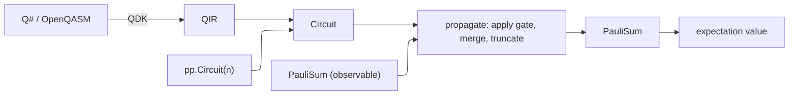

# paulipropagation-qdk

Pauli propagation for circuits compiled with the Microsoft Quantum Development Kit (QDK).

An observable is evolved backwards through a circuit as a truncated sum of Pauli strings. This
gives expectation values `<0| U† O U |0>` on hundreds of qubits without a state vector.

- Rust engine, Python API.
- Circuits come from QIR, so from Q# or OpenQASM, or are built gate by gate.
- Algorithms, conventions and defaults follow
  [PauliPropagation.jl](https://github.com/SparqleSim/PauliPropagation.jl).



## Install

Python 3.10 or later; wheels for Linux and Windows (x86-64, arm64) and macOS (arm64). On x86-64
the processor has to support x86-64-v2 (SSE4.2 and POPCNT: Intel from 2009, AMD from 2011):

```bash
pip install paulipropagation-qdk
```

From source, with Rust:

```bash
uv venv --python 3.12 .venv && source .venv/bin/activate
uv pip install maturin
maturin develop --release
```

## Example

```python
from qdk import qsharp
import paulipropagation_qdk as pp

qsharp.init(target_profile=qsharp.TargetProfile.Base)
qsharp.eval("""
operation Main() : Result[] {
    use qs = Qubit[32];
    for _ in 1..8 {
        for i in 0..30 { Rzz(0.1, qs[i], qs[i + 1]); }
        for i in 0..31 { Rx(0.1, qs[i]); }
    }
    MResetEachZ(qs)
}
""")
circuit = pp.circuit_from_qir(str(qsharp.compile("Main()")))

observable = pp.PauliSum(circuit.num_qubits)
observable.add("Z", [15])

evolved = pp.propagate(circuit, observable, max_weight=6, min_abs_coeff=1e-4)
print(len(evolved), evolved.overlap_with_zero())
```

| Notebook | From | Shows |
| --- | --- | --- |
| `samples/pauli_propagation.ipynb` | Q# | 100 qubits, truncation, noise, gradients, an error estimate, a surrogate |
| `samples/pauli_propagation_openqasm.ipynb` | OpenQASM 2 and 3 | 100 qubits, truncation, noise, gates that the QDK decomposes, input parameters |

## Features

| | |
| --- | --- |
| Circuits | QIR from Q# or OpenQASM; `pp.Circuit` built gate by gate |
| Gates | H, X, Y, Z, S, SX, T and adjoints; CX, CY, CZ, SWAP, CCX; RX, RY, RZ, RXX, RYY, RZZ; `rotation(paulis, qubits, theta)`; unitary and transfer matrices on up to 5 qubits |
| Noise | Pauli channels on up to 6 qubits; depolarizing, dephasing, Pauli X, Y, Z noise; amplitude damping; the Pauli errors of a QDK `NoiseConfig` |
| Pauli sums | real or complex coefficients, up to 512 qubits; sums, products, commutators |
| Pictures | observables backwards, states forwards |
| Expectation values | in the zero, plus, computational basis and maximally mixed states, or a state given as a Pauli sum |
| Truncation | eight rules, see [below](#truncation) |
| Gradients | all angles in one backward and one forward pass |
| Surrogates | propagate once, evaluate at any angles |
| Sampling | resampling, propagation with resampling, single random paths |
| Error estimate | mean squared error of a truncation |
| Symmetries | merging of translations on rings and tori, or of any symmetry given as a function |
| Threads | all cores; every coefficient is the same bit for bit on any number of threads |

## Usage

### Truncation

A sum is truncated after every gate.

| Option | Drops a term when |
| --- | --- |
| `max_weight` | it has more non-identity operators than this |
| `min_abs_coeff` (default `1e-10`) | its coefficient is smaller than this in absolute value |
| `min_rel_coeff` | its coefficient is smaller than this fraction of the largest in the sum |
| `max_freq` | more rotations than this split the Pauli string on its way |
| `max_sins` | it took more sine branches of rotations than this |
| `weight_damping=(gamma, threshold)` | `abs(coeff) * 10**(-gamma * weight) < threshold` |
| `custom_truncation` | this function of the label and the coefficient returns true |
| `max_terms` | the sum has more terms than this and the term is not among the largest |

- A Clifford gate changes only signs, so after one only `max_weight`, `weight_damping` and
  `custom_truncation` drop anything.
- `max_terms` bounds memory and time whatever the circuit does. It cannot be combined with
  `max_freq` or `max_sins`.
- Truncated results are approximations without an error bound for a given circuit. Check
  convergence by tightening the truncation; `estimate_mse` gives the average error over angles.

### Noise

Noise channels are gates of the circuit, and the result is the exact expectation value of the
noisy circuit, not a sample.

```python
from qdk.simulation import NoiseConfig

noise = NoiseConfig()
noise.rzz.set_depolarizing(0.01)
noise.rx.set_pauli_noise([("Z", 0.002)])
circuit = pp.circuit_from_qir(str(qsharp.compile("Main()")), noise=noise)

circuit.depolarizing(0.02, q)                        # or channel by channel
circuit.amplitude_damping(0.01, q)
circuit.pauli_channel([q0, q1], [("XZ", 0.01)])
```

Of a `NoiseConfig`, the Pauli errors of every gate are used. Qubit loss is rejected, and noise
on the trailing measurements is dropped.

### States

With `heisenberg=False` the sum is a state in the Pauli basis and the circuit acts on it from
the first gate to the last. A coefficient times `2^n` is the expectation value of its string.

```python
state = pp.PauliSum(2)                      # |00><00| = (I + Z)(I + Z) / 4
for paulis in ("II", "IZ", "ZI", "ZZ"):
    state.add(paulis, [0, 1], 0.25)

evolved = pp.propagate(circuit, state, heisenberg=False)
print(evolved.coeff("ZZ", [0, 1]) * 4)      # <ZZ> after the circuit
```

`observable.overlap_with_pauli_sum(state)` is `Tr[state observable]`.

### Gates from matrices

```python
circuit.unitary([q0, q1], matrix)           # 4 x 4 complex, q0 the most significant bit
circuit.transfer_map([q], transfer_matrix)  # 4 x 4 real
```

Entry `(i, j)` of a transfer matrix is the factor of the Pauli string `i` in the image of the
string `j` of an observable. Strings are numbered in base 4, with I, X, Y, Z as 0 to 3 and the
first qubit as the lowest digit.

### Pauli sums

```python
total = pp.PauliSum(n, dtype=complex)                   # complex coefficients
hamiltonian = 0.5 * zz + 0.3 * x                        # + - * with numbers
derivative = 1j * hamiltonian.commutator(observable)    # also a.product(b)
```

### Symmetries

Pauli strings that a symmetry of the circuit and the state maps to each other have the same
expectation value and can be merged into one term.

```python
for _ in range(layers):
    observable = pp.propagate(layer, observable, max_weight=6).translation_merge()
```

| Method | Merges |
| --- | --- |
| `translation_merge()` | translations on a ring |
| `translation_merge(nx, ny)` | translations on a torus; the qubit in column `x` of row `y` is `y * nx + x` |
| `symmetry_merge(representative)` | any symmetry: `representative` maps a label to the label that stands for its images |

### Gradients

```python
value, derivatives = pp.gradient(circuit, observable, max_weight=6, min_abs_coeff=1e-6)
```

- `derivatives[k]` belongs to the rotation with the angle `circuit.angles[k]`; a T gate is a
  rotation. `circuit.with_angles(angles)` is the circuit with other angles.
- `state` is `'zero'`, `'plus'`, `'mixed'`, the list of the qubits that are 1, or a Pauli sum.
- Exact without truncation, approximate with it. The circuit must have no noise.

### Surrogates

A `Surrogate` propagates once for all angles. Evaluating it returns the same sum as
`propagate` with those angles and `min_abs_coeff=0`, bit for bit.

```python
surrogate = pp.Surrogate(circuit, observable, max_weight=5, max_freq=30)
for angles in candidates:
    value = surrogate.evaluate(angles).overlap_with_zero()
```

For circuits of Clifford gates and rotations, with `max_weight`, `max_freq` and `max_sins`.

### Sampling

```python
estimate = pp.mcpropagate(circuit, observable, max_size=100_000, seed=1)
```

| Function | Does |
| --- | --- |
| `pp.resample(sum, target_size)` | drops terms at random and scales the others, so that the sum is unchanged on average |
| `pp.mcpropagate(...)` | propagates and resamples whenever a gate leaves more than `max_size` terms |
| `pp.mcsample(circuit, sum, samples)` | follows single random paths, one branch at every rotation |

Resampling methods are `'semideterministic'` (default), `'systematic'` and `'multinomial'`.
A `seed` makes each of them reproducible on every platform.

### The error of a truncation

```python
mse = pp.estimate_mse(circuit, observable, 100_000, max_weight=6)              # any angles
mse = pp.estimate_mse(circuit, observable, 100_000, thetas=0.3, max_weight=6)  # angles up to 0.3
```

The mean squared error of `max_weight`, `max_freq`, `max_sins` or a rule on the Pauli string,
averaged over angles drawn uniformly from `[-thetas, thetas]`. The observable is one Pauli
string.

### Threads

```python
evolved = pp.propagate(circuit, observable, max_weight=6, threads=8)
```

By default all cores are used once the sum is large enough. The result does not depend on the
number of threads. On processors with performance and efficiency cores, the number of
performance cores is usually fastest.

### OpenQASM

```python
from qdk import openqasm, qsharp

qir = openqasm.compile("""
OPENQASM 3.0;
include "stdgates.inc";
qubit[3] q;
output bit[3] c;
h q[0];
cx q[0], q[1];
cry(0.4) q[1], q[2];
c = measure q;
""", target_profile=qsharp.TargetProfile.Base)
circuit = pp.circuit_from_qir(str(qir))
```

- OpenQASM 2 and 3. Controlled rotations, `U`, gate modifiers and the gates that a program
  defines arrive as Clifford gates and rotations, decomposed by the QDK.
- `input` parameters are bound when compiling: `import_openqasm(source, name="Main",
  program_type=ProgramType.File)`, then `openqasm.compile(code.qasm_import.Main, *values)`.
- The QDK reduces angles to the range from 0 to 2π, so `circuit.angles` holds `2π - 0.4` for
  `rx(-0.4)`. Expectation values do not change.

### QIR and qubit numbering

- A QIR program is one unitary circuit, optionally followed by measurements. Branching on
  measurement results is rejected.
- Observables refer to the qubits of the QIR program. These are the qubits of the Q# register
  in allocation order, or of the OpenQASM registers in the order of their declarations, as
  long as the program measures only at the end.

## How it works

- Terms are kept in arrays, ordered by Pauli string. A rotation updates coefficients in place,
  creates one new term per term it splits, and one merge adds up equal strings and drops the
  truncated ones. This is the vector backend of PauliPropagation.jl.
- For threads, the sum is divided into zones by the commutation of each string with a few
  fixed strings. A rotation pairs the zones up, and every pair is worked on by one thread.
- `pauliprop::reference` is a second, simple propagation on a hash map, which the tests
  compare the engine with.

## Building and testing

```bash
uv pip install maturin pytest numpy qdk stim
maturin develop --release
cargo test
pytest
```

Both suites cap their own memory, so a propagation that fails to truncate ends the run instead
of exhausting the machine.

## Documentation

| | |
| --- | --- |
| [docs/verification.md](https://github.com/filipw/paulipropagation-qdk/blob/main/docs/verification.md) | what the results are checked against, and the runs that were made |
| [docs/comparison.md](https://github.com/filipw/paulipropagation-qdk/blob/main/docs/comparison.md) | comparison with PauliPropagation.jl, Qiskit pauli-prop and cuPauliProp: features and timings |

## License and attribution

Apache-2.0. The algorithms, conventions and defaults follow
[PauliPropagation.jl](https://github.com/SparqleSim/PauliPropagation.jl), which is licensed
under Apache-2.0 as well.
