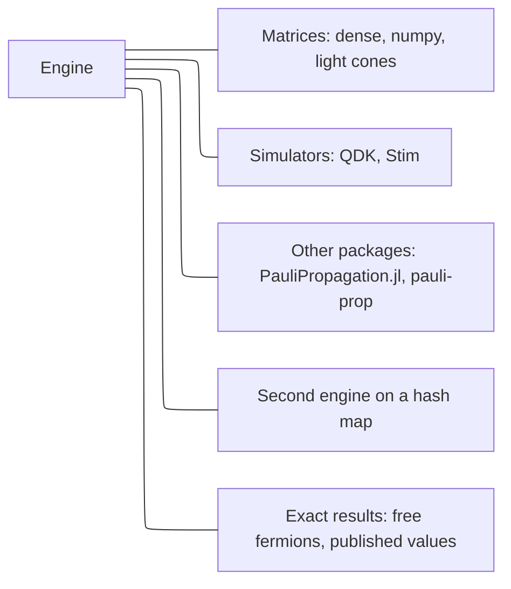

# Verification

Every rule is checked against references that share no code with the engine, and the engine
as a whole against a second implementation of the same rules.



## References

| Reference | Checks | Tests |
| --- | --- | --- |
| Dense matrices | every Clifford gate and all 63 rotations on 3 qubits on all 64 strings against `U† P U`; noise and transfer maps against Kraus operators; states against `U rho U†`; complex coefficients; overlaps; every truncation against a term-by-term propagation | `crates/core/tests` |
| QDK simulators | random Q# circuits through QIR against the QDK state vector, as observables and states; with a `NoiseConfig`, against a million shots of the noisy simulators | `tests/test_*qdk*.py`, `test_truncation_options.py` |
| numpy | random unitaries and channels from Kraus operators against a state vector and a density matrix | `test_matrix_gates_against_numpy.py` |
| PauliPropagation.jl | truncated sums term by term on circuits it built: every truncation, noise, complex coefficients, states, matrix gates, its README example, 100 qubits | `test_against_julia.py` |
| Tests of PauliPropagation.jl | the cases of its test files, with its Clifford tables and circuit builders as data | `test_conformance_*.py` |
| Second engine | `pauliprop::reference` on a hash map: every term and every bit of every coefficient, under every truncation, in both pictures, on registers of several words, on any number of threads | `engines_agree.rs`, `test_threads.py` |
| `max_terms` | bit for bit against one gate at a time on the hash map with all terms sorted by size | `capped.rs`, `test_max_terms.py` |
| Free fermions | RXX and RZ circuits on 100 qubits against the exact evolution of Majorana pairs | `test_free_fermions.py` |
| Arithmetic, symmetries, gradients, surrogates | products against matrix products; merged translations by hand; gradients against the parameter-shift rule; surrogates against the propagation, bit for bit; all four against PauliPropagation.jl | `algebra.rs`, `gradient.rs`, `surrogate.rs`, `test_algebra.py`, `test_gradient.py`, `test_surrogate.py`, `test_features_against_julia.py` |
| Random methods | with a seed, against the same methods written in Python on the same numbers; without, averages within six standard errors; error estimates against an enumeration of all paths and against PauliPropagation.jl | `montecarlo.rs`, `test_montecarlo.py` |
| Random numbers | xoshiro256** seeded through splitmix64: for five seeds, the first six numbers and the 1001st of the reference C code by Blackman and Vigna | `montecarlo.rs` |
| pauli-prop | random circuits of Clifford gates and rotations without truncation, in both pictures; runs where pauli-prop is installed | `test_against_qiskit_pauli_prop.py` |
| Stim | Clifford circuits on 1 to 512 qubits: string and sign in both pictures, expectation values in stabilizer states; the 127-qubit kicked Ising circuit at its Clifford point | `test_against_stim.py` |
| Light cones | 300 qubits, shallow circuits of all gates, observables at the register ends and at the 64-bit word boundaries against a state vector of the light cone | `test_light_cones.py` |
| Published results | see [below](#published-results) | `test_published_results.py` |

## Published results

| Source | Checked |
| --- | --- |
| Kim et al., Nature 618, 500 (2023); arXiv:2308.09109 | 127-qubit kicked Ising circuit: the three observables have size 1 at the Clifford point, on one path with 15, 25 and 34 sines; magnetization at the exact points |
| arXiv:2306.05400 | `H Rz(θ)^d H` gives `cos(dθ)`, all of it at the frequency `d` |
| arXiv:2409.01706 | error of weight truncation on scrambled circuits: the bound `(2/3)^(k+1)` and the error identity |
| arXiv:2411.19896 | mean squared sine of a rotation with a small angle; bound on the error of dropping paths with many sines |
| arXiv:2501.13101 | amplitude damping on two qubits; depolarizing noise damps by `(1-p)^weight` |
| arXiv:2512.12094 | number of Pauli strings left after merging translations on rings and tori |

## Random circuits against PauliPropagation.jl

`tools/compare_random_cases.py` makes cases from seeds, propagates each with both packages
and compares.

| Part of a case | Drawn from |
| --- | --- |
| Register | 1 to 130 qubits (1 byte to five 64-bit words per string) |
| Circuit | up to 80 gates: all Clifford gates of PauliPropagation.jl; rotations on 1 to 4 qubits with random, small and special angles; frozen rotations; T gates; depolarizing and Pauli noise; amplitude damping; unitary and transfer matrices on 1 to 3 qubits |
| Sum | 1 to 4 strings, real or complex, as an observable or a state |
| Truncation | any combination of `max_weight`, `min_abs_coeff`, `min_rel_coeff`, `max_freq`, `max_sins`, `weight_damping`, or none |

| Compared | In |
| --- | --- |
| Every coefficient of the propagated sum | all cases |
| Overlaps with the zero, plus, a computational basis and the maximally mixed state | all cases |
| The sum with translations on a ring or torus merged | one case in five |
| The gradient with respect to every angle | circuits of Clifford gates and rotations |

Tolerance: 1e-11 times the largest coefficient of the reference, fixed before the runs.

| Seeds | Cases | Coefficients | Derivatives | Merged sums | Largest sum | Differences |
| --- | ---: | ---: | ---: | ---: | ---: | ---: |
| 0 to 99,999 | 100,000 | 5,205,822 | 115,978 | 18,610 | 3,498 terms | 0 |
| 100,000 to 1,099,999 | 1,000,000 | 51,724,210 | 1,177,255 | 185,514 | 6,733 terms | 0 |
| 2,000,000 to 2,003,999, `--growth 18` | 4,000 | 428,262 | 5,288 | 710 | 7,056 terms | 0 |

Apple M4 Pro, PauliPropagation.jl 0.9.2, Julia 1.13.3. The million cases took 16 minutes:

| Of the million cases | |
| --- | ---: |
| Observables / states | 700,431 / 299,569 |
| Complex coefficients | 199,686 |
| More than 32 qubits | 150,494 |
| Gates | 29,749,538 |
| `max_weight` set | 349,636 |
| `min_abs_coeff` positive | 599,082 |
| Each other truncation | about 150,000 |
| Gradients compared | 117,706 |

| Largest difference, all runs | Relative to the largest coefficient |
| --- | ---: |
| Overlap | 2.4e-15 |
| Coefficient | 1.8e-15 |
| Derivative | 1.8e-15 |
| Merged coefficient | 2.1e-15 |

What it shows:

- Agreement on every gate rule, sign, truncation and their order, in both pictures.
- N clean cases bound the share of such cases that differ below 3/N at 95 % confidence.

What it does not show:

- A convention that both packages have wrong. The references that share nothing with either
  cover that.
- Large sums: the cases are small.
- Resampling, sampled paths, surrogates, `max_terms` and the QIR reader, which are not part of
  a case.

Notes for repeating it:

- `:SY` and `:ZZpihalf` of PauliPropagation.jl are built as products of Clifford gates, not as
  rotations by a quarter turn. A rotation leaves terms of the size of rounding, which a
  truncated gradient can depend on.
- The factor of `:ZZpihalf` that changes the weight of a string is put where it acts first.
  Otherwise a starting term above `max_weight` is dropped in the middle of the gate.
- Gradients use `rewindgradient` on a `PauliSum`. On a `VectorPauliSum`, PauliPropagation.jl
  keeps starting terms that a truncation would drop for as long as gates leave them unchanged;
  on a `PauliSum` it drops them after the first gate, as this package does.

## Rounding

| Circuit | Reference | Largest error of a coefficient |
| --- | --- | ---: |
| 12,000 gates on 5 qubits, 5,998 rotations, no truncation | PauliPropagation.jl with 256-bit coefficients and angles | 6.1e-16 |

`test_rounding_stays_small_through_a_deep_circuit` allows 1e-14.

## Running the checks

```bash
cargo test
pytest
python tools/compare_random_cases.py --first 0 --count 100000 --jobs 8
```

The last needs Julia and a clone of PauliPropagation.jl next to this repository. So does
regenerating `tests/reference`:

```bash
julia --project=tools/julia -e 'using Pkg; Pkg.instantiate()'
julia --project=tools/julia tools/julia/generate_reference.jl
julia --project=tools/julia tools/julia/generate_features.jl
```

Both test suites cap their own memory (`crates/core/tests/common/memory.rs`,
`tests/conftest.py`).
